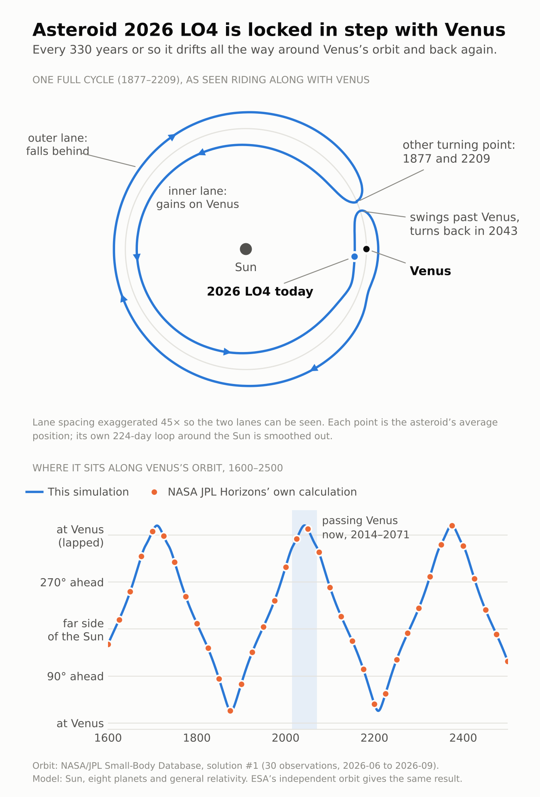
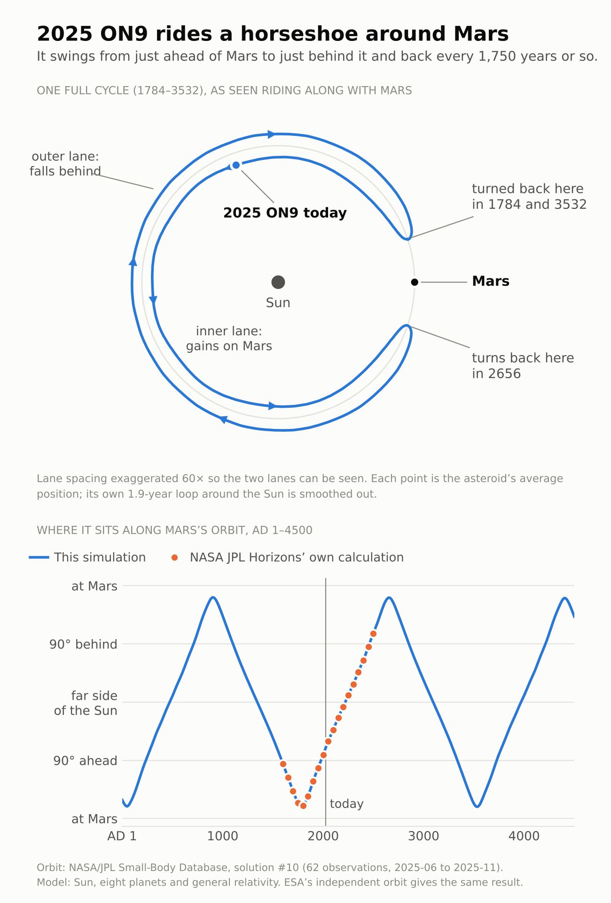

# Co-orbital companions of Venus and Mars: 2026 LO4 and 2025 ON9

Two catalogued asteroids turn out, on simulation, to be locked in a 1:1 orbital resonance
with a planet. As far as a literature search on 10 November 2026 could tell, neither had
been reported as such.

| | **2026 LO4** | **2025 ON9** |
|---|---|---|
| Companion of | Venus | Mars |
| Kind | compound horseshoe / quasi-satellite | horseshoe |
| Full cycle | about 330 years | about 1,750 years |
| Right now | beside Venus, in its quasi-satellite phase (2014–2071) | about 110° ahead of Mars and receding; last turned back near Mars in 1784 |
| Size (from brightness) | roughly 0.4–0.9 km | roughly 55–125 m |
| Orbit (a, e, i) | 0.7218 au, 0.194, 25.1° | 1.5216 au, 0.214, 4.0° |
| Resonance lasts (all orbit variants) | from ~3,550 years ago to ~17,200–17,900 years ahead | from at least 8,100 years ago to at least 10,600 years ahead; 25 of 33 variants for the full 60,000 years simulated |
| Why it matters | apparently the lowest-eccentricity Venus co-orbital known, and the first that stays inside Earth's orbit | apparently a sixth horseshoe companion of Mars |

<p>
  
  
</p>

The full account, with numbers, checks and limits, is in **[WRITEUP.md](WRITEUP.md)**.

## Status: read this first

- **Unreviewed.** This analysis was carried out by Claude, an AI model made by Anthropic, at
  the repository owner's request, in one session on 10 November 2026. No specialist has
  checked it.
- **Novelty is not established.** The asteroids themselves were discovered by sky surveys.
  What is offered here is the recognition of how they move relative to Venus and Mars.
  Searches found no earlier mention and the published catalogues predate both objects, but
  that is not proof that nobody has noticed.
- **The orbits are young.** 2026 LO4 rests on 30 observations over 112 days, 2025 ON9 on 62
  observations over 141 days. Both will be refined.
- **The dynamics are well checked.** The model reproduces NASA JPL Horizons' own trajectory
  for both objects at 37 dates between 1600 and 2500, ESA's independently computed orbits
  give the same behaviour, and the conclusions hold across the orbits' stated uncertainty.

## Quick start

Developed and tested with Python 3.13.

```sh
pip install -r requirements.txt
python -m pytest -q                      # six fast checks, a few seconds

python scripts/check_propagation.py 2026_LO4    # model vs JPL's own propagation
python scripts/compare_horizons.py 2026_LO4     # model vs JPL Horizons, 1600-2500
python scripts/nominal.py 2026_LO4 --years 2000 # the resonance itself, a quick look
python scripts/make_figures.py                  # redraw the figures from results/
```

Use `2025_ON9` in place of `2026_LO4` for the Mars object.

## Reproducing everything

```sh
QUICK=1 sh scripts/run_all.sh    # short spans, ~7 min, writes to quick/ only
sh scripts/run_all.sh            # as in the write-up, ~2 h on two CPU cores
```

| Step | Script | What it answers | Time (2 cores) |
|---|---|---|---|
| Screen a zone | `screen_zone.py venus\|earth\|mars` | Which catalogued objects near a planet's orbit are in resonance now? | 3 / 4 / 12 min |
| Propagation check | `check_propagation.py OBJ` | Does the model land on JPL's elements at a second epoch? | seconds |
| Horizons check | `compare_horizons.py OBJ` | Does it follow JPL Horizons' trajectory over 900 years? | < 1 min |
| ESA check | `compare_esa.py OBJ` | Does ESA's independent orbit behave the same? | 2–3 min |
| Nominal orbit | `nominal.py OBJ` | Cycle length, turning points, how long the resonance lasts | 3–6 min |
| Close approaches | `close_approaches.py OBJ` | Actual distances to the planet and to Earth | < 1 min |
| Orbit uncertainty | `clones.py OBJ` | Do orbits drawn from the covariance agree? | 22–26 min |
| Thermal drift | `yarkovsky.py 2025_ON9` | Does a Yarkovsky-like drift break the horseshoe? | 17 min |
| Figures | `make_figures.py` | | seconds |

Every script has `--help`. The long ones accept `--years` and `--n` for shorter runs, and
`--summarise-only` (or `--classify-only`) to rebuild their tables from a saved run.

What is in `results/` was written by these scripts. The three longest integrations (the two
clone ensembles and the drift test, about an hour of computing) were run on 10 November 2026
with the same routines before the code was arranged into this layout. Their tables here were
rebuilt from those saved runs with the current scripts, and the current scripts were
confirmed to reproduce the saved trajectories over ±1,000–2,000 years to the precision at
which they were stored. Raw run files are large and are not in the repository (`runs/` is
git-ignored).

## Layout

```
coorb/                 the package
  ephem.py             planet positions and masses from JPL DE421
  nbody.py             the N-body model (REBOUND IAS15, optional relativity and drift)
  classify.py          reading resonance type and duration off the resonant angle
  orbits.py            input files, clone sampling from the covariance matrix
  summary.py           the numbers quoted in the write-up
scripts/               one command-line script per analysis step, plus run_all.sh
data/
  zones/               every catalogued object near Venus's, Earth's and Mars's orbit
  objects/             the two orbits: JPL elements and covariance, ESA elements, settings
  horizons/            JPL Horizons osculating elements, 1600-2500, every 25 years
results/               tables and summaries produced by the scripts
figures/               the two figures above
tests/                 fast checks of the building blocks
.claude/skills/        the search procedure written up as a Claude Code skill
```

## Running the search with Claude Code

The procedure that found these two objects is written up as a skill in
`.claude/skills/coorbital-asteroid-search/SKILL.md`. Open the repository in Claude Code and
ask it to search a planet's co-orbital zone, or to check a particular asteroid. The skill
covers fetching the candidate list, screening, the literature check, the validation steps
and what may and may not be claimed. It has been tested on the Venus, Earth and Mars zones
only, and the skill itself has not yet been run end to end from a fresh start.

## How it works, briefly

1. **Candidates.** The JPL Small-Body Database was queried for every object whose
   semi-major axis lies within a planet's co-orbital zone and whose orbit is reasonably well
   determined (condition code ≤ 5): 20 objects near Venus, 136 near Earth, 134 near Mars.
2. **Simulation.** Each object is integrated backward and forward as a massless particle
   under the Sun and eight planets, started from JPL's DE421 planetary positions, with
   REBOUND's IAS15 integrator.
3. **Classification.** An object in 1:1 resonance has a mean longitude that swings back and
   forth relative to the planet's instead of drifting steadily past it. The centre and extent
   of the swing give the type (Trojan, horseshoe, quasi-satellite, compound).
4. **Scrutiny.** Anything interesting and not in the published catalogues is re-run with
   relativity, compared with JPL Horizons and ESA, and repeated for dozens of orbits drawn
   from the JPL covariance matrix.

The screening also recovers known companions (Earth's Trojans 2010 TK7 and 2020 XL5,
quasi-satellites such as Kamoʻoalewa and Zoozve, the Mars Trojans and horseshoes), which is
the main reason to trust what it says about the two new ones. It is not perfect: section 6
of the write-up lists one known Venus companion it mislabels and three it never sees.

## Data

All inputs were retrieved on 10 November 2026 and are kept as a snapshot, because orbit
solutions change as observations accumulate.

- **JPL Small-Body Database** (`ssd-api.jpl.nasa.gov`): zone lists, orbital elements and
  covariance matrices.
- **JPL Horizons** (`ssd.jpl.nasa.gov/api/horizons.api`): osculating elements, 1600–2500.
- **ESA NEO Coordination Centre** (`neo.ssa.esa.int`): independently computed orbits.
- **JPL DE421** planetary ephemeris, through the `de421` and `jplephem` packages.

The JPL and ESA values were fetched through an AI assistant's web tool and transcribed into
the files here. The transcription of the two orbits is verified by the checks themselves:
JPL's elements at one epoch integrate onto JPL's elements at another to ten significant
figures, and onto all 37 Horizons rows. The zone lists were not re-verified row by row; an
error there would affect only that object's screening result.

`scripts/fetch_data.py` can download fresh copies into `data/fresh/`. It was written without
access to those servers and has not been run against them, so treat it as a starting point.

No licence file is included; add the one you prefer before publishing.

## References

- Pan & Gallardo, *An attempt to build a dynamical catalog of Solar System co-orbitals*,
  [arXiv:2410.20015](https://arxiv.org/abs/2410.20015)
- *The invisible threat: assessing the collisional hazard posed by the undiscovered Venus
  co-orbital asteroids* (2025), [arXiv:2505.15968](https://arxiv.org/abs/2505.15968)
- *The dynamically hazardous asteroid 2025 TV10: a new co-orbital asteroid of Venus*,
  A&A 706, L9 (2026), [arXiv:2601.21554](https://arxiv.org/abs/2601.21554)
- Carruba, Caritá, Aljbaae, Araujo, Domingos et al., *Co-orbital asteroids of terrestrial
  planets affected by the von Zeipel–Lidov–Kozai mechanism*, Celest. Mech. Dyn. Astron. 138, 8 (2026),
  [doi:10.1007/s10569-026-10275-5](https://link.springer.com/article/10.1007/s10569-026-10275-5)
- Rein & Liu, *REBOUND*, A&A 537, A128 (2012); Rein & Spiegel, *IAS15*, MNRAS 446, 1424
  (2015); Tamayo et al., *REBOUNDx*, MNRAS 491, 2885 (2020)
